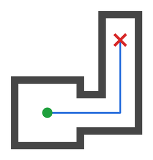

# updates

the gazebo test maps, how to run the tests, and changes made (updated 11pm 11/16)

## the gazebo test maps

there are 9 gazebo tests. each one is a flight in a map of its own. the drone starts in the middle of a room (always at 0,0) and follows a path through a corridor to the goal

expected results:

| test | the flight must end | time |
| --- | --- | --- |
| `test1` | at the goal | ~65 s |
| `test2` | at the goal | ~120 s |
| `test3` | at the goal | ~92 s |
| `test4` | at the goal | ~147 s |
| `test5` | at the goal | ~172 s |
| `test6` | at the goal | ~177 s |
| `test7` | at the goal | ~97 s |
| `test8` | at the goal | ~68 s |
| `test9` | blocked: the drone must stop and report that it cannot go on | 120 to 160 s |

test1



test2


test3


test4


test5


test6


test7


test8


test9


in the pictures, grey is a wall, the green dot is the start, the red x is the goal and the blue line is the path given to the drone. orange is the block that only appears during the flight (dynamic object detection or something like that)

### 1. open ubuntu

### 2. build the project

```bash
cd ~/ros2_ws
source /opt/ros/humble/setup.bash
colcon build --packages-select reactive_uav_navigation
source install/setup.bash
```

`~/ros2_ws` is the workspace, the folder that has `src/reactive_uav_navigation` in it. use your own if it has another name.

these four lines are needed again in every new ubuntu window. after them, run any of the tests below.

### all 9 gazebo tests

```bash
SIM_GUI=1 bash src/reactive_uav_navigation/test/sim/run_sim_tests.sh ~/sim_out/run_1
```

- the script starts px4, gazebo, mavros, the camera bridge and the navigator node by itself and stops them again at the end. do not start any of them yourself.
- the drone takes off, flies the 9 maps one after the other and lands. this takes about 31 minutes. leave the window open.
- for every test one line is printed: pass or fail, how the flight ended, the time, the distance flown and the closest wall.
- the last line says how many of the 9 tests passed.
- the results are kept in `~/sim_out/run_1`

### running only one gazebo test

the script flies every test in the file it is given. so make a copy of the file and leave only the test you want in it:

```bash
cp src/reactive_uav_navigation/test/sim/scenarios.yml ~/one_test.yml
nano ~/one_test.yml
```

in nano, delete every test under `scenarios:` except the one you want. a test starts at its `- name:` line and ends before the next `- name:` line. keep everything above `scenarios:`. save with ctrl o and enter, exit with ctrl x.

then give the copy to the script as the second argument:

```bash
bash src/reactive_uav_navigation/test/sim/run_sim_tests.sh ~/sim_out/one_test ~/one_test.yml
```

one test takes about 3 minutes with the start of the simulation due to drone speed (0.3m/s), limitations,  etc. etc.

**‘wsl —shutdown’ in powershell if anything exits early**

**‘tail -F ~/sim_out/run_1/node.log’ in a separate ubuntu terminal for node logs**

## main changes:

- drone turns each picture into points, knowing where walls and obstacles are
    - it remembers where obstacles are for 15s, rather than forgetting it in the next frame
    - directions that the camera cannot see are counted as ‘blocked’ in case
- looks 1 second ahead rather than 0.1s
- keeps ~0.8m away from walls
- if it’s positioned in front of an obstacle, it finds the end of the obstacle and attempts to fly around it
    - if it cannot see the end of the obstacle, it goes side to side
    - if it is blocked for an extended period, it can turn around to look around for potential paths
- has four states: following path, avoiding an obstacle, blocked, goal reached
- top speed is 0.3m/s, which is why it looks kinda slow
- uses ros-humble-ros-gzharmonic-bridge rather than the other bridge that didn’t work

## improvements(maybe?):

- maybe speed improvements but we can just play a sped-up version of the video